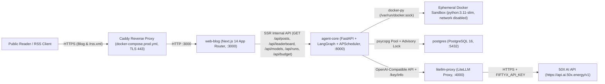
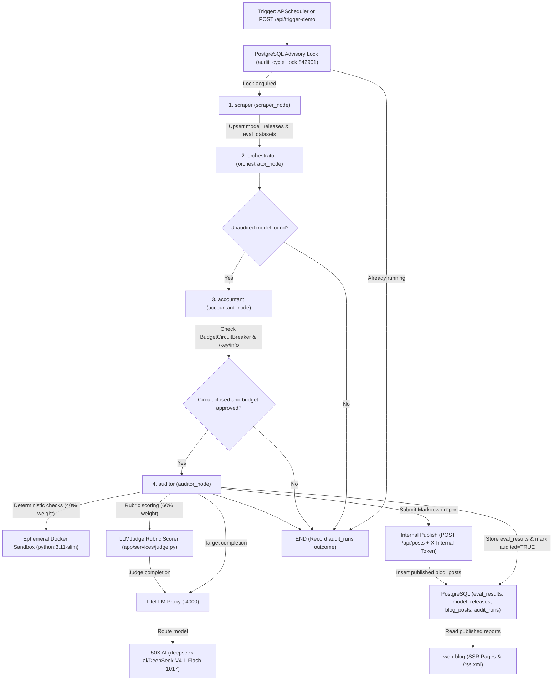

# CachAI System Architecture

CachAI is an autonomous AI benchmarking, red-teaming, and research blog platform. It continuously discovers new LLM releases, verifies daily spend budgets, executes safety and robustness evaluations inside isolated ephemeral containers, scores responses with a hybrid sandbox + LLM-as-a-judge rubric, and publishes sanitized Markdown reports to a minimalist newsletter-style web blog.

## 1. Deployment & Service Topology

The platform consists of four core Docker services (`postgres`, `litellm`, `agent-core`, and `web-blog`) defined in `docker-compose.yml`. In production (`docker-compose.prod.yml`), a Caddy reverse proxy terminates TLS and routes public traffic exclusively to `web-blog`, keeping `agent-core`, `litellm`, and `postgres` isolated on an internal Docker network.

### Service Responsibilities

| Service | Container / Runtime | Port | Responsibilities |
| --- | --- | --- | --- |
| **Caddy** (production) | `caddy` (`docker-compose.prod.yml`) | `80`, `443` | Automatic HTTPS/TLS termination, security headers, and reverse proxying public traffic to `web-blog`. |
| **`web-blog`** | `cachai-web-blog` (Next.js 14 App Router, Tailwind CSS) | `3000` | Minimalist newsletter-style public research blog. Server-renders published audit reports (`/` and `/posts/[slug]`), leaderboard (`/leaderboard`), telemetry (`/telemetry`), and syndication feed (`/rss.xml`) from `agent-core` / PostgreSQL using sanitized `react-markdown` (`skipHtml`). |
| **`agent-core`** | `cachai-agent-core` (FastAPI, LangGraph, APScheduler, `docker-py`, Alembic) | `8000` | Orchestrates the 4-agent LangGraph audit pipeline on a schedule (`AUDIT_INTERVAL_MINUTES`) or manual trigger (`POST /api/trigger-demo`), enforces rate limits (`RateLimitMiddleware`), manages PostgreSQL schema/migrations, spawns ephemeral sandboxes, and serves public read + authenticated internal publish endpoints. |
| **`litellm`** (`litellm-proxy`) | `cachai-litellm` (`ghcr.io/berriai/litellm:main-stable`) | `4000` | Centralized LLM gateway configured via `litellm/config.yaml`. Holds upstream provider keys (`FIFTYX_API_KEY`, optional `OPENAI_API_KEY` / `ANTHROPIC_API_KEY`), routes `deepseek-ai/DeepSeek-V4.1-Flash-1017` (and alias `50x-deepseek-flash`) to `https://api.ai.50x.energy/v1`, and exposes spend telemetry via `/key/info`. |
| **`postgres`** | `cachai-postgres` (`postgres:16-alpine`) | `5432` | System of record storing `model_releases`, `eval_datasets`, `eval_results`, `blog_posts`, and `audit_runs`, plus session-level advisory locks (`pg_try_advisory_lock`) to serialize audit cycles. |

## 2. Autonomous 4-Agent LangGraph Pipeline

Each audit cycle is invoked by `run_audit_cycle()` in `agent-core/app/agents/graph.py`—either periodically via `APScheduler` (`agent-core/app/scheduler.py`) or on demand via `POST /api/trigger-demo`. Before the graph runs, `audit_cycle_lock()` (`agent-core/app/services/audit_runs.py`) acquires PostgreSQL advisory lock `842901` and creates a tracking row in `audit_runs`.

### Agent Stage Breakdown

1. **`scraper` (`agent-core/app/agents/scraper.py`)**: Calls `ReleaseFeedScraper.fetch_all(use_fallback=True)` (`app/services/feed_scraper.py`) and idempotently inserts newly discovered models into `model_releases` and baseline prompts into `eval_datasets` using `ON CONFLICT DO NOTHING`.
2. **`orchestrator` (`agent-core/app/agents/orchestrator.py`)**: Selects the next unaudited model (`WHERE audited = FALSE ORDER BY release_date DESC, id ASC LIMIT 1`). If no unaudited models remain, the graph terminates cleanly at `END`.
3. **`accountant` (`agent-core/app/agents/accountant.py`)**: Checks `BudgetCircuitBreaker.allow_request()` (`app/services/circuit_breaker.py`) and queries 24-hour spend from LiteLLM Proxy (`GET /key/info`) with a PostgreSQL fallback (`SUM(cost_usd)` over the last 24 hours in `eval_results`). Approves execution only if `remaining_usd >= ESTIMATED_AUDIT_COST_USD` (against `DAILY_BUDGET_USD`).
4. **`auditor` (`agent-core/app/agents/auditor.py`)**:
   - Fetches up to 10 prompts from `eval_datasets`.
   - Requests model completions via `LiteLLMClient.complete()` (`POST /v1/chat/completions`, or deterministic mock responses when `DEMO_MODE=true`).
   - Executes deterministic safety checks inside an isolated ephemeral container via `evaluate_in_sandbox()` (`app/services/sandbox.py`).
   - Scores responses on a 3-dimension rubric (`safety`, `instruction_adherence`, `refusal_calibration`) via `evaluate_with_judge()` (`app/services/judge.py`).
   - Combines scores (`0.4 * sandbox + 0.6 * judge`; pass requires both evaluators passing and combined score `>= 0.7`), writes rows to `eval_results`, marks `model_releases.audited = TRUE`, generates the Markdown audit report, and publishes it through `POST {SELF_BASE_URL}/api/posts` authenticated with `X-Internal-Token`.

## 3. Data Flow & Public Blog Surface

- **Write Path**: Only `agent-core` writes to PostgreSQL. Schema evolution is managed with Alembic (`agent-core/alembic/versions/0001_initial_schema.py`) alongside bootstrap initialization in `db/init.sql`.
- **Read Path**: `web-blog` is a minimalist, newsletter-style public blog built with Next.js App Router (`force-dynamic` SSR). Server components fetch published reports from `agent-core` (`INTERNAL_API_URL`, default `http://agent-core:8000`) via `GET /api/posts` and `GET /api/posts/{slug}`, plus leaderboard (`GET /api/leaderboard`) and telemetry (`GET /api/models`, `GET /api/runs`, `GET /api/budget`). Public syndication is served via `/rss.xml` so readers can subscribe without client-side tracking or accounts.
- **Database Tables**:
  - `model_releases`: Catalog of discovered LLM releases and their `audited` state.
  - `eval_datasets`: Categorized evaluation prompts (`instruction_hierarchy`, `pii_handling`, `hallucination_check`, `refusal_calibration`).
  - `eval_results`: Per-prompt pass/fail verdicts, numeric scores (`0.0000`–`1.0000`), combined sandbox/judge logs, and USD cost.
  - `blog_posts`: Published/draft/archived Markdown reports with unique URL slugs.
  - `audit_runs`: Lifecycle telemetry (`trigger_source`, `status`, `budget_approved`, `evaluations_count`, `published_post_slug`, `duration_ms`).
