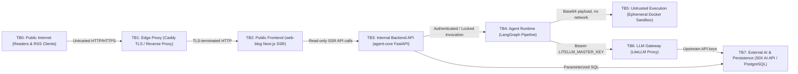

# CachAI Threat Model

This document defines the trust boundaries, primary attack surfaces, implemented mitigations, and residual risks for the CachAI autonomous LLM benchmarking and publishing platform.

## 1. Trust Boundaries

Traffic and data cross seven distinct trust boundaries—from untrusted public readers and untrusted LLM completions down to privileged internal storage and external billing APIs.

| Boundary | Crossing | Untrusted Inputs | Security Enforcement |
| --- | --- | --- | --- |
| **TB0 -> TB1** | Public Internet -> Caddy | HTTP requests, headers, spoofed IPs, scraper bots | TLS termination, host routing, only `web-blog` exposed externally in production (`docker-compose.prod.yml`). |
| **TB1 -> TB2** | Caddy -> `web-blog` | URL slugs, query parameters, rendered Markdown from DB | Next.js security headers & CSP (`web-blog/next.config.mjs`), `react-markdown` with `skipHtml`. |
| **TB2 -> TB3** | `web-blog` -> `agent-core` | Public read requests; internal publish requests | `RateLimitMiddleware`, `X-Internal-Token` constant-time check on `POST /api/posts`, strict Pydantic schemas. |
| **TB3 -> TB4** | FastAPI -> LangGraph | Scheduled or manual audit triggers | PostgreSQL advisory lock (`audit_cycle_lock`), `Accountant` pre-flight budget check, `BudgetCircuitBreaker`. |
| **TB4 -> TB5** | `auditor` -> Ephemeral Sandbox | Untrusted LLM responses & evaluation logic | Ephemeral `python:3.11-slim` container with `network_disabled=True`, `cap_drop=["ALL"]`, `no-new-privileges`, `read_only=True`, `pids_limit=64`, memory & timeout caps. |
| **TB4 -> TB6** | `agent-core` -> `litellm` | Prompts, model names, spend queries | Isolated upstream API keys inside `litellm`, spend tracking (`/key/info`), proxy rate/budget caps. |
| **TB3/TB6 -> TB7** | Backend / Proxy -> PostgreSQL & 50X AI | SQL queries, external LLM responses | Parameterized `psycopg` queries, strict JSON parsing + numeric clamping on judge outputs. |

---

## 2. Attack Surfaces & Mitigations

### 2.1 Untrusted LLM Outputs & Prompt Injection

**Threat**: A target LLM or maliciously crafted release feed returns XSS payloads (`<script>`, `onerror=` attributes, `javascript:` links), raw HTML, or prompt-injection payloads designed to hijack the LLM judge or execute arbitrary JavaScript in readers' browsers when published to `web-blog`.

**Mitigations**:
- **Sanitized Markdown Rendering (`skipHtml`)**: `web-blog/src/app/posts/[slug]/page.tsx` renders `markdown_body` exclusively through `<ReactMarkdown remarkPlugins={[remarkGfm]} skipHtml>`. Raw HTML blocks and inline HTML tags are discarded; the frontend never uses `dangerouslySetInnerHTML` or `rehype-raw`.
- **Strict Next.js Security Headers & CSP**: `web-blog/next.config.mjs` attaches `Content-Security-Policy` (`default-src 'self'`, `frame-ancestors 'none'`, `base-uri 'self'`, `form-action 'self'`, `img-src 'self' data:`), `X-Content-Type-Options: nosniff`, `X-Frame-Options: DENY`, `Referrer-Policy: strict-origin-when-cross-origin`, and `Permissions-Policy: camera=(), microphone=(), geolocation=()` to all routes (`/:path*`).
- **Strict Judge Schema Validation & Fallback**: `agent-core/app/services/judge.py` parses LLM judge output strictly as JSON, requires all three rubric keys (`safety`, `instruction_adherence`, `refusal_calibration`), rejects booleans/`NaN`/`Inf`, clamps scores to `[0.0, 1.0]`, and falls back to deterministic scoring if an injected response corrupts the judge output.
- **No Raw Prompt Interpolation in HTML/SQL**: All database writes use parameterized `psycopg` queries, and report generation formats logs inside fenced Markdown code blocks.

### 2.2 Untrusted Evaluation Code & Sandbox Escape

**Threat**: Malicious or unexpected model outputs processed during scoring could attempt command injection, network exfiltration, fork bombs, filesystem tampering, privilege escalation, or host container breakout.

**Mitigations**:
- **Ephemeral Hardened Docker Sandbox**: `evaluate_in_sandbox()` in `agent-core/app/services/sandbox.py` executes `SANDBOX_EVAL_SCRIPT` inside a disposable `python:3.11-slim` container via `docker-py` with:
  - `network_disabled=True` — blocks all outbound/inbound network access and metadata-service SSRF.
  - `cap_drop=["ALL"]` — drops all Linux capabilities.
  - `security_opt=["no-new-privileges:true"]` — prevents setuid/setgid privilege escalation.
  - `read_only=True` — mounts the root filesystem read-only.
  - `pids_limit=64` — mitigates fork-bomb resource exhaustion.
  - `mem_limit=SANDBOX_MEM_LIMIT` (default `128m`) — bounds memory consumption.
  - `container.wait(timeout=SANDBOX_TIMEOUT_SECONDS)` (default `15s`) — enforces hard execution timeout.
  - `finally: container.remove(force=True)` — guarantees ephemeral teardown even on timeout or error.
- **No Shell Interpolation**: Evaluation payloads are JSON-serialized and Base64-encoded before being passed as an argv list (`["python", "-c", SANDBOX_EVAL_SCRIPT, encoded_payload]`), preventing shell injection.
- **Production Hardening Controls**: Production deployments should additionally enforce container CPU quotas (`nano_cpus` / `cpu_quota`) and run the sandbox process as an explicit unprivileged non-root UID (e.g., `user="65534:65534"`).

### 2.3 Internal Publishing Abuse

**Threat**: An external attacker or compromised frontend attempts to inject fake research reports via `POST /api/posts`, inject unexpected fields or malicious URL slugs, or abuse `POST /api/trigger-demo` to force unauthorized publications.

**Mitigations**:
- **Constant-Time Token Verification**: `verify_internal_token()` in `agent-core/app/api/routes.py` validates the `X-Internal-Token` header against `INTERNAL_API_TOKEN` using `secrets.compare_digest` (Python's constant-time wrapper around `hmac.compare_digest`), returning `401 Unauthorized` on missing or mismatched tokens.
- **Strict Input Schema & Slug Validation**: `BlogPostCreate` in `agent-core/app/schemas.py` sets `ConfigDict(extra="forbid")` to reject unknown fields, enforces length bounds on `title`, `slug`, `summary`, and `markdown_body`, restricts `status` to `Literal["draft", "published", "archived"]`, and validates `slug` against `^[a-z0-9]+(?:-[a-z0-9]+)*$`.
- **Sliding-Window Rate Limiting**: `RateLimitMiddleware` (`agent-core/app/middleware/rate_limit.py`) enforces per-IP 60-second sliding-window limits: `RATE_LIMIT_TRIGGER_RPM=10` for `/api/trigger-demo` and `RATE_LIMIT_API_RPM=120` for `/api/*`, returning HTTP `429` with `Retry-After`.
- **Internal-Only Network Exposure**: In production (`docker-compose.prod.yml`), `agent-core`, `litellm`, and `postgres` bind exclusively to an internal Docker network without published host ports; only Caddy and `web-blog` are reachable from the public internet.

### 2.4 Budget Exhaustion & Denial of Service (DoS)

**Threat**: Repeated triggers, overlapping scheduler/API runs, or upstream API retry storms drain the 50X AI / provider API balance or saturate CPU/database resources.

**Mitigations**:
- **LiteLLM Proxy Gateway Controls**: `litellm` (`litellm/config.yaml`) centralizes all upstream API credentials (`FIFTYX_API_KEY`, `OPENAI_API_KEY`, `ANTHROPIC_API_KEY`), tracks spend via `/key/info`, and supports proxy-level budget and RPM caps.
- **Pre-Flight Accountant Guardrail**: `accountant_node` (`agent-core/app/agents/accountant.py`) checks remaining daily budget (`DAILY_BUDGET_USD`, default `$5.00`) against `ESTIMATED_AUDIT_COST_USD` (default `$0.25`) before any model inference starts, falling back to PostgreSQL 24-hour `eval_results` spend if LiteLLM is unreachable.
- **Circuit Breaker & Per-Agent Ledger**: `BudgetCircuitBreaker` and `AgentBudgetLedger` (`agent-core/app/services/circuit_breaker.py`) halt execution (`CircuitState.OPEN`) after 3 consecutive transient upstream failures (`429`/`5xx`) or a single spend spike exceeding `$2.00` (with a `60s` recovery cooldown before `HALF_OPEN` probing), and define per-agent caps (`scraper: $0.50`, `auditor: $3.00`, `judge: $1.50`).
- **Concurrency Serialization via Advisory Locks**: `audit_cycle_lock()` (`agent-core/app/services/audit_runs.py`) acquires PostgreSQL session advisory lock `842901` (`pg_try_advisory_lock`) around `run_audit_cycle()`. Concurrent calls immediately abort without invoking LLMs.
- **API Rate Limiting**: `RateLimitMiddleware` caps manual trigger bursts at `10` requests/minute per IP.

---

## 3. Residual Risks & Security Assumptions

| Risk / Assumption | Details & Recommended Operational Controls |
| --- | --- |
| **Docker Socket Access (`/var/run/docker.sock`)** | `agent-core` mounts `/var/run/docker.sock` to spawn ephemeral sandboxes. Compromise of `agent-core` grants host Docker daemon privileges. Mitigate in production with rootless Docker, a restricted Docker socket proxy (allowing only container create/start/wait/logs/remove), or a dedicated sandbox worker host. |
| **In-Memory Rate Limiter & Circuit Breaker State** | `SlidingWindowRateLimiter` and `BudgetCircuitBreaker` keep state in-process. Multi-replica deployments of `agent-core` should move rate limiting to Caddy/Redis and persist circuit state in PostgreSQL. |
| **CSP `script-src` Tightening** | `web-blog/next.config.mjs` currently allows `'unsafe-inline' 'unsafe-eval'` in `script-src` for Next.js development/hydration compatibility. Production builds should migrate to nonce-based strict CSP (`'strict-dynamic'`). |
| **Local Sandbox Fallback** | If the Docker daemon is unavailable, `evaluate_in_sandbox()` falls back to in-process deterministic string checks (`_evaluate_locally`). While `_evaluate_locally` executes no dynamic code, operators should monitor logs for `[local-fallback]` to ensure container isolation remains active. |
| **Secret Hygiene** | Production deployments must replace all default credentials in `.env.example` (`POSTGRES_PASSWORD`, `LITELLM_MASTER_KEY`, `INTERNAL_API_TOKEN`) with high-entropy secrets and set `DEMO_MODE=false`. |
