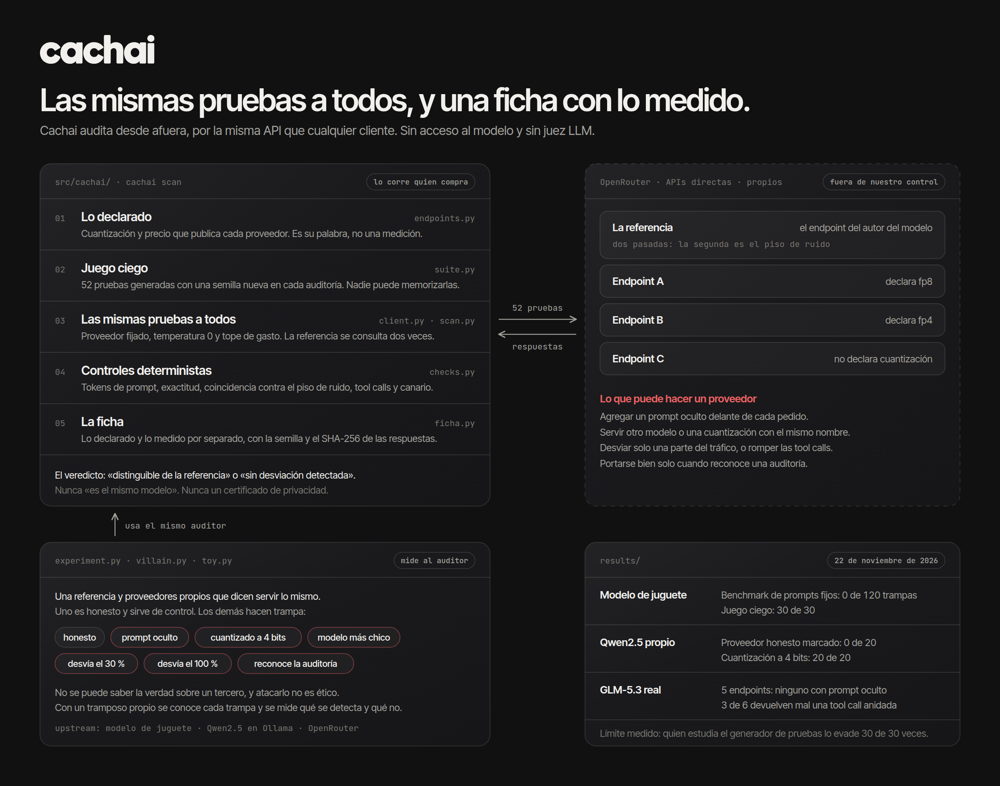

# Diseño: Cachai, auditor de proveedores de tokens

Platanus Hack 26 · Track AI Security · team-43 · 2026-11-22

_Fuente editable: [arquitectura.svg](arquitectura.svg)._

Las etiquetas de confianza siguen una sola regla: **medido** (hay un resultado reproducible en el repo), **probable** (lo indican fuentes externas o el código, sin medición propia) y **supuesto** (no verificado; se dice cómo se verificaría).

## 1. El problema

Un mismo modelo abierto lo sirven decenas de proveedores. GLM-5.3 tiene 47 endpoints en OpenRouter, 14 sin cuantización declarada, con un precio de salida que varía 4,7 veces (API pública, 21-11-2026). Quien compra tokens no puede verificar qué recibe. Terceros ya midieron diferencias reales: 11 de 31 endpoints de Llama servían otra distribución ([Gao et al., arXiv 2410.20247](https://arxiv.org/abs/2410.20247)) y 24 de 103 endpoints quedaron bajo la referencia en el *Endpoint Accuracy Index* de Artificial Analysis (octubre y noviembre de 2026).

Es un problema de seguridad, no solo de calidad: una evaluación de seguridad vale para unos pesos y una configuración. Si no se verifica qué modelo responde, esas evaluaciones no cubren lo desplegado. Es el problema abierto de verificar características declaradas sin acceso al modelo ([*Open Problems in Technical AI Governance*, arXiv 2407.14981](https://arxiv.org/abs/2407.14981), §5.4.1).

### 1.1 Modelo de amenaza

El adversario es el proveedor. Controla el servidor, ve cada petición y puede cambiar qué modelo responde. No controla la referencia ni el auditor, y no conoce la semilla de una auditoría antes de recibirla.

| # | Qué hace el proveedor | Qué ve el comprador | Cómo lo detecta Cachai | Nivel | Estado |
|---|---|---|---|---|---|
| A1 | Inyecta un system prompt propio delante del pedido del cliente | Respuestas normales | Excedente **constante** de tokens de prompt frente a la referencia en mensajes mínimos; si el prompt cambia el comportamiento, el canario | E2 | **Medido** con el tramposo propio |
| A2 | Desvía todo el tráfico a un modelo más barato y responde con el nombre del pedido | El nombre del modelo correcto | Exactitud y coincidencia con la referencia en tareas con respuesta calculable (Fisher exacto) | E2 | **Medido** con el tramposo propio |
| A3 | Desvía solo una fracción del tráfico | Casi siempre respuestas buenas | Prueba combinada sobre todas las fallas; la potencia crece con el número de tareas | E2 | **Medido**: 30 % detectado en 6/30 con 20 tareas y en 30/30 con 80 |
| A4 | Rompe las tool calls (parser o plantilla) | Agentes que fallan | Tres tools con esquema estricto (objetos anidados, enteros con rango, `$ref`), la mitad en streaming; se valida nombre, claves, tipos y valores | E2 | **Medido** en GLM-5.3: tres de seis endpoints devuelven un objeto anidado como texto |
| A5 | **Reconoce las auditorías** y se porta bien solo con ellas | Un benchmark limpio | Juego ciego: pruebas generadas con una semilla nueva en cada auditoría | E2 | **Medido**: el benchmark fijo lo detecta 0/120 veces; el ciego, 30/30 en A1, A2 y A1+A3 |
| A6 | Reconoce además **la forma** de las pruebas ciegas (estudió el generador) | Un benchmark limpio | No lo detecta. Mitigación: auditar con tráfico real del comprador (§7) | E2 | **Medido como límite**: 0/30 en todas las trampas |
| A7 | Falsea el `usage` (cuenta de tokens) | Factura coherente | El excedente de tokens desaparece; queda la prueba de comportamiento | E2 | Límite declarado |
| A8 | Mira o guarda los datos | Nada | No se puede probar desde afuera. Solo E1 (política) o E3 (TEE con atestación) | E1/E3 | Fuera del alcance de la medición |

### 1.2 Límites

- **Caja negra.** Solo hay acceso a la API, como cualquier comprador. Sin pesos ni GPU propia.
- **Referencia.** Es el endpoint first-party si existe; si no, una referencia elegida o el consenso de los endpoints. La referencia también es un endpoint: se mide equivalencia con ella, no con los pesos.
- **Costo y tiempo.** 52 pruebas por endpoint, más una segunda pasada a la referencia como piso de ruido, y un tope de gasto por auditoría (`--max-usd`, 2 USD por defecto). Auditar cinco endpoints de GLM-5.3 costó USD 0,16 y tardó 7 minutos, porque el endpoint del autor limita las cuentas nuevas a 20 pedidos por minuto.
- **No determinismo.** Temperatura 0 y semilla fija reducen la variación, pero no la eliminan entre hardware distinto, y hay modelos que no repiten ni sus propias respuestas: GLM-5.3, que razona siempre, coincidió consigo mismo en 0 de 10 frases. Por eso la coincidencia se compara contra un piso de ruido y no contra un 100 % ideal; con un modelo así, ese control no tiene potencia.
- **Ética.** Solo se audita con uso normal de la API desde una cuenta propia. El proveedor tramposo es un proxy nuestro; nunca se ataca a terceros.

### 1.3 Supuestos

| # | Supuesto | Estado y cómo se verifica |
|---|---|---|
| S1 | Con el proveedor fijado (`provider.only`, sin fallback), OpenRouter devuelve los `prompt_tokens` nativos de ese proveedor. | **Probable.** En la auditoría de GLM-5.3, los cinco endpoints contaron los mismos tokens de prompt que el del autor en los seis mensajes. Falta compararlo con el tokenizer público. |
| S2 | Dos endpoints honestos del mismo modelo, a temperatura 0, no se distinguen con p < 0,01 en una auditoría. | **Medido con proveedores propios**: el control honesto nunca se marcó con el juguete (0/90) ni con Qwen2.5 (0/20). **Sin medir** entre dos proveedores honestos con hardware distinto: el piso de ruido es la misma referencia en otra llamada. |
| S3 | Distintas plantillas de chat cambian el conteo de tokens en una cantidad chica y constante. | **Supuesto.** El auditor tolera una diferencia constante de hasta 3 tokens (`checks.TOKEN_TEMPLATE_TOLERANCE`). El margen no está calibrado por proveedor (§5, R2); en GLM-5.3 la diferencia fue cero en los cinco endpoints. |
| S4 | El endpoint first-party sirve el modelo declarado. | **Supuesto.** Si no hay first-party o es dudoso, la referencia pasa a ser el consenso. |
| S5 | El proveedor no distingue una auditoría por la cuenta o la clave. | **Probable** a través de OpenRouter, que media la llamada. En APIs directas el proveedor ve la clave: se audita con la clave del propio comprador. |

### 1.4 Casos difíciles

- **Sustitución parcial**: cada control ve pocas fallas. Se suman en una prueba combinada y se reporta cuántas tareas harían falta.
- **Modelos con razonamiento**: pueden agotar `max_tokens` antes de responder, y algunos no dejan apagarlo (GLM-5.3 responde «Reasoning is mandatory»). `--extra-tokens` suma margen a cada prueba, salvo a las de conteo. Una respuesta vacía cuenta como tarea fallida, pero no como coincidencia con la referencia. Pasó de verdad: un endpoint que corta en la mitad del límite pedido salió con 9 de 20 tareas sin margen y con 19 de 20 con margen.
- **Límites de pedidos**: el endpoint del autor puede limitar a quien audita (20 pedidos por minuto para cuentas nuevas en GLM-5.3). Un 429 no dice nada del modelo: el auditor espera y repite la misma prueba, hasta ocho veces.
- **Respuestas con formato**: «12,345», «**12345**» o «12345.» son la misma respuesta. Se normaliza antes de comparar.
- **Proveedores caídos**: un error no detiene la auditoría; se registra como dato de confiabilidad.

### 1.5 Lo que dejo fuera, con razón

| Fuera | Por qué |
|---|---|
| Certificar privacidad | Desde afuera no se puede probar que algo no se guarda. Se muestra la política declarada (E1) con esa etiqueta. |
| Identidad exacta del modelo | La evidencia estadística solo puede decir «distinguible» o «sin desviación detectada». |
| Tokens de razonamiento ocultos | Los auditores que existen fueron rotos (Token Inflation); prometerlo sería falso. |
| Geolocalizar GPUs | A través de OpenRouter no se puede. |
| Juez LLM | Ver D1. |

## 2. Arquitectura

Son cuatro piezas: el **auditor**, que mide endpoints reales; el **laboratorio**, que mide al auditor contra proveedores tramposos propios; la **ficha**, que publica lo medido con su evidencia; y las **cuentas**, que guardan el historial de cada persona y lo muestran en un panel.

**Auditor** (`src/cachai/`)
1. **Lo declarado** (`endpoints.py`): lee de la API pública de OpenRouter la cuantización y el precio de cada endpoint del modelo, y elige cuáles auditar (el first-party más los más baratos, o los que se pidan).
2. **Juego de pruebas** (`suite.py`): con una semilla, genera 52 pruebas: 6 mensajes mínimos para contar tokens, 20 tareas (suma, producto, ordenar, repetir), 8 tool calls con tres esquemas estrictos (la mitad en streaming), 8 canarios (un secreto en el system prompt y un pedido de revelarlo) y 10 frases cortas de texto libre. Sin semilla genera el juego público, siempre igual. Una semilla reproduce la auditoría solo con la misma versión del juego: las fichas anteriores al juego de 52 pruebas se repiten fijando el commit.
3. **Cliente** (`client.py`): una llamada por prueba, con el proveedor fijado (`provider.only`, `allow_fallbacks: false`), temperatura 0 y semilla 7, normal o en streaming. **Nunca lanza**: un error vuelve dentro de la respuesta y se clasifica (clave inválida, sin crédito, falla del proveedor).
4. **Ejecución** (`scan.py`): los endpoints se auditan en paralelo (hasta cuatro a la vez), con un tope de gasto compartido. Una clave inválida detiene ese endpoint en vez de reintentar; un 429 se espera y se repite.
5. **Controles** (`checks.py`): de respuestas crudas a una medición por endpoint. Tokens: excedente constante o variable frente a la referencia, con una tolerancia de 3 tokens constantes por la plantilla. Tareas: exactitud con intervalo de Wilson y coincidencia con la referencia. Coincidencia: cuántas respuestas (tareas y texto libre) son idénticas a las de la referencia, comparado con Fisher contra lo que coincide el piso de ruido (la misma referencia en otra llamada); así el no determinismo del servidor no se cuenta como trampa. Tool calls: validez estricta de nombre, claves, tipos y valores en tres esquemas, comparada con la referencia. Canario: un juez determinista (el secreto aparece literal en la respuesta o no). Cada comparación con la referencia es un **test exacto de Fisher a dos colas** con α = 0,01 fijado antes de medir; si ningún control individual dispara, una prueba combinada suma todas las fallas.
6. **Ficha** (`ficha.py`): JSON y Markdown con lo declarado (E1), lo medido (E2), el motivo de cada marca, los límites, la semilla y el SHA-256 de las respuestas crudas, que se guardan en JSONL.

**Laboratorio** (`villain.py`, `toy.py`, `experiment.py`)
- `villain.py`: proveedor tramposo propio, un proxy compatible con la API de OpenAI que reenvía a un upstream real o al juguete. Puede inyectar un system prompt, desviar una fracción del tráfico a un modelo más barato (reescribiendo el nombre del modelo en la respuesta) y portarse bien cuando reconoce una auditoría: por los prompts exactos del juego público o por las plantillas del ciego.
- `toy.py`: modelo de juguete con reglas fijas (`toy-large` correcto, `toy-small` con fallas conocidas), para probar sin claves.
- `experiment.py`: la línea base. Una referencia y varios proxies hacia el mismo upstream (uno honesto y el resto tramposos), auditados con el juego fijo y con el ciego, R veces con semillas distintas. Corre en memoria (TestClient) con el juguete, contra Ollama con Qwen2.5 (la referencia en Q8 y proveedores que sirven Q4, Q2 o el 0.5B) o contra OpenRouter con un tope de gasto.

**Cuentas y panel** (`sesion.py`, `cuentas.py`, `db.py`, `migrations/`)
- **Identidad:** el inicio de sesión es de Clerk. El servidor verifica el token de sesión con las claves públicas de la instancia (JWKS) y comprueba el emisor y el origen que lo pidió, así que no guarda ningún secreto de Clerk. El identificador del usuario es el `sub` del token.
- **`cachai login`:** el CLI inventa un verificador y abre la página con su SHA-256 (el desafío) y un código corto que se ve igual en la terminal y en el navegador. La persona lo autoriza con su sesión y el CLI canjea el verificador, una sola vez, por una clave `cachai_…`. La clave no pasa por la URL ni por el historial del navegador; el servidor guarda solo su SHA-256 y el equipo la guarda con permisos 0600.
- **Qué se sube:** después de cada `cachai scan`, la ficha (conteos por endpoint y el SHA-256 de la evidencia). Las claves de los proveedores y las respuestas crudas no salen del equipo. Subir dos veces la misma ficha no la duplica.
- **Base de datos:** Postgres en Railway, con SQLAlchemy y migraciones de Alembic que el servidor aplica al arrancar. Cinco tablas: `usuarios`, `claves`, `autorizaciones_cli`, `auditorias` (la ficha completa en JSONB) y `mediciones` (una fila por endpoint y auditoría, que es lo que suma el panel). Cada consulta filtra por el usuario de la sesión.
- **Degradación:** si la base no responde al arrancar, la demo en vivo sigue sin cuentas; si el servidor de cuentas no responde durante un `scan`, la auditoría corre igual y la ficha queda en local.
- **Límite:** la ficha la calcula el cliente, así que el panel muestra lo que ese cliente dice haber medido. Sirve para llevar el historial propio, no como prueba ante terceros; para eso está la evidencia con su SHA-256.

## 3. Decisiones y alternativas descartadas

| # | Decisión | Alternativa descartada | Por qué |
|---|---|---|---|
| D1 | **Sin juez LLM**: pruebas con respuesta calculable y controles deterministas | Un LLM que compare respuestas libres | El auditor no debería poder ser engañado por lo que audita, y la ficha tiene que ser reproducible. Un juez LLM se puede inyectar desde la respuesta auditada y no da el mismo veredicto dos veces. |
| D2 | **Juego ciego con semilla guardada** | Suite fija pública, o suite fija privada (K2 Vendor Verifier guarda el 50 % en privado) | Una suite fija se puede memorizar; una privada, filtrar. La semilla nueva hace que cada auditoría sea inédita y la semilla guardada permite repetirla exactamente. El experimento mide la diferencia (A5). |
| D3 | **Fisher exacto con α fijado antes de medir**, más una prueba combinada | Umbrales elegidos mirando los datos, o comparar tasas brutas | Con 20 tareas las tasas son discretas y chicas; Fisher es exacto en ese régimen. Fijar α antes evita ajustar el umbral al resultado. La prueba combinada recupera potencia cuando una sustitución parcial reparte pocas fallas en cada control. |
| D4 | **Referencia first-party por la misma ruta** que los demás endpoints | Correr los pesos oficiales en GPU propia (como Artificial Analysis) | Sin GPU y con el mismo camino de red, la comparación aísla al proveedor. Es una referencia más débil que los pesos y lo decimos (§1.2). Si no hay first-party, se usa el consenso. |
| D5 | **Niveles de evidencia separados** (E1 declarado, E2 medido, E3 atestado) | Un sello único de «proveedor confiable» | Un sello único mezcla lo que el proveedor dice con lo que se midió. Separarlos impide certificar algo que la medición no respalda, como la privacidad. |
| D6 | **Evidencia verificable**: respuestas crudas en JSONL y su SHA-256 en la ficha | Publicar solo el veredicto | Cualquiera puede comprobar que la ficha sale de esas respuestas, y volver a correr la misma semilla. |
| D7 | **Un error es un dato**: el cliente nunca lanza | Abortar la auditoría ante una falla | La confiabilidad es parte de lo que se mide, y un proveedor caído no debería impedir auditar a los demás. |
| D8 | **Proveedor tramposo propio** para medir al auditor | Probar contra proveedores reales sospechosos | No se puede saber la verdad de un tercero, y atacarlo no es ético. Con un tramposo propio se conoce cada trampa y se puede medir qué detecta el auditor y qué no. |
| D9 | **Lo paga quien compra** | Que lo pague el proveedor (como Benchlist) | Si paga el auditado, el incentivo es aprobarlo. |

## 4. Plan de medición

| Medición | Qué es | Métrica y estado |
|---|---|---|
| **M1. Tests** | 72 tests de punta a punta en memoria, sin red ni claves (`tests/`) | Todos pasan antes de cada cambio. **Medido**: 72/72. |
| **M2. Línea base con el juguete** | Benchmark fijo contra juego ciego, cinco proveedores (uno honesto), 30 repeticiones por celda, 20 y 80 tareas | Detección por trampa con IC95 de Wilson; falsas alarmas del honesto. **Medido** (§6). |
| **M3. Modelos reales servidos por nosotros** | Qwen2.5 1.5B servido con Ollama: Q8 como referencia y piso de ruido, y proveedores propios que sirven Q4, Q2, el 0.5B, un prompt oculto o un desvío del 30 %, más uno honesto (`cachai experimento --ollama`, 20 repeticiones) | Falsas alarmas del honesto ≤ 1/20 para aceptar α = 0,01; detección por trampa con IC95. **Medido**: honesto 0/20; prompt oculto, Q4, Q2 y 0.5B 20/20 cada uno; desvío del 30 % 8/20 (IC95 22-61 %); piso de ruido 30/30 en las 20. El Q4 se marcó solo por coincidencia: su exactitud no alcanzó a distinguirse de la referencia ([tabla](../results/linea-base/ollama-qwen2.5-t20.md)). |
| **M4. Proveedores reales** | `cachai scan` sobre los endpoints de un modelo con varios proveedores | Fichas con su evidencia en `results/proveedores/`. **Medido** en una auditoría de GLM-5.3 (cinco endpoints contra el del autor, 364 respuestas sin errores): sin prompt oculto, ninguno distinguible, y tres de seis endpoints devuelven un objeto anidado de una tool call como texto. El texto libre no tiene potencia con ese modelo (piso de ruido 0 de 10). |

**Reglas de evidencia**

1. **Un resultado del juguete no es un hallazgo sobre proveedores.** Prueba el mecanismo; los hallazgos salen de M3 y M4.
2. **Toda tasa lleva su muestra y su intervalo.** 30/30 se reporta como IC95 89-100 %, no como «100 %».
3. **Todo experimento tiene un control honesto.** Sin él no se sabe si una detección es trampa o ruido.
4. **El umbral se fija antes de medir** y no se cambia después de ver los datos.
5. **Lo que no se detecta también se publica.** A6 es un límite medido y está en el README.

## 5. Riesgos

| # | Riesgo | Mitigación |
|---|---|---|
| R1 | **Comparaciones múltiples**: hasta tres pruebas de Fisher y el control de tokens por endpoint, sobre varios endpoints, inflan las falsas alarmas por encima de α. | El control honesto mide la tasa real (M3). La ficha reporta cada p-valor y no acusa. Si M3 da más de lo esperado, se corrige por Bonferroni. |
| R2 | **Tokens de plantilla**: un proveedor honesto con otra plantilla de chat deja un excedente constante y se confunde con un prompt oculto. | Se tolera una diferencia constante de hasta 3 tokens. Es un margen supuesto, no calibrado por proveedor; en la auditoría de GLM-5.3 no hizo falta (diferencia cero en los cinco endpoints). Calibrarlo con mensajes de largos distintos sigue **pendiente**. |
| R3 | **Evasión por plantillas** (A6). | Medida y declarada. Auditar con una muestra del tráfico real del comprador (§7). |
| R4 | **Potencia insuficiente** para sustituciones chicas. | Reportar la muestra; `--tasks 80` detectó el 30 % en 30/30. El costo de la auditoría crece con la potencia y se muestra antes. |
| R5 | **Referencia comprometida o cuantizada.** | Usar el consenso como alternativa y decir siempre contra qué se comparó. |
| R6 | **El proveedor falsea el `usage`** (A7). | Queda la prueba de comportamiento; está en los límites de la ficha. |
| R7 | **Modelos no deterministas a temperatura 0**: el control de coincidencia, que es el que delata una cuantización, pierde potencia. | El piso de ruido evita las falsas alarmas (GLM-5.3: 0 de 10, nadie marcado). La ficha lo deja a la vista. Recuperar la potencia exige comparar distribuciones (§7). |

## 6. Hallazgos

**Experimento de línea base** (`results/linea-base/`, upstream de juguete, 30 repeticiones por celda):

| Trampa | Benchmark fijo | Ciego, 20 tareas | Ciego, 80 tareas | Ciego, tramposo que conoce las plantillas |
|---|---|---|---|---|
| Ninguna (control) | 0/30 | 0/30 | 0/30 | 0/30 |
| Prompt oculto (A1) | 0/30 | 30/30 | 30/30 | 0/30 |
| Desvío del 30 % (A3) | 0/30 | 6/30 (IC95 10-37 %) | 30/30 | 0/30 |
| Desvío del 100 % (A2) | 0/30 | 30/30 | 30/30 | 0/30 |
| Prompt oculto y desvío del 30 % | 0/30 | 30/30 | 30/30 | 0/30 |

Qué controles dispararon con 20 tareas: el prompt oculto, por el excedente constante de tokens y por el canario (el prompt inyectado ordena revelar secretos); el desvío total, por exactitud y canario; el desvío del 30 %, solo por la prueba combinada.

**Una lección del propio experimento.** La primera corrida con 80 tareas mostró que el benchmark fijo detectaba al tramposo. Era un error del laboratorio: el tramposo memorizaba solo las 20 tareas del juego público por defecto y hacía trampa en las otras 60. Se corrigió (memoriza el juego fijo completo, de cualquier tamaño) y hay un test que lo comprueba. Sin el control de evasión, ese error habría pasado por un resultado favorable al benchmark fijo.

Repetida con el juego de 52 pruebas, la línea base da el mismo patrón: control 0/30, prompt oculto y desvío total 30/30, desvío del 30 % 12/30 y evasión por plantillas 0/30 (`results/linea-base/juguete-t20-52-pruebas.md`).

**Modelo real servido por nosotros** (`results/linea-base/ollama-qwen2.5-t20.md`, Qwen2.5 1.5B en Ollama, 20 auditorías por caso, juego de 48 pruebas):

| Lo que sirve el proveedor | Marcado | Qué lo delató |
|---|---|---|
| Lo mismo que la referencia (control) | 0/20 (IC95 0-16 %) | Nada |
| Prompt oculto | 20/20 (IC95 84-100 %) | Tokens de prompt de más y coincidencia |
| Cuantización a 4 bits | 20/20 | Solo la coincidencia: 9 a 15 de 30 contra 30 de 30 del piso |
| Cuantización a 2 bits | 20/20 | Coincidencia; exactitud en 14 de 20 |
| Modelo tres veces más chico | 20/20 | Coincidencia; filtra el secreto en 19 de 20 |
| Desvío del 30 % al modelo chico | 8/20 (IC95 22-61 %) | Coincidencia |

La cuantización a 4 bits es el caso que justifica el control de coincidencia: acierta casi lo mismo que la referencia y la exactitud nunca la marcó.

**Proveedores reales** (`results/proveedores/`, GLM-5.3 en OpenRouter, una auditoría de cinco endpoints contra el del autor, 364 respuestas sin errores):

- Ningún endpoint agrega un prompt oculto (diferencia de tokens cero en los cinco) y ninguno se distingue de la referencia.
- El endpoint del autor, SiliconFlow y Novita devuelven el objeto anidado de una tool call como texto con JSON adentro (5 de 8 válidas); los dos de Wafer y Decart lo devuelven como objeto (8 de 8). La referencia es la que falla, así que nadie queda marcado (p = 0,2).
- El piso de ruido de texto libre fue 0 de 10: el modelo no repite sus propias frases. Sin el piso, los cinco endpoints habrían salido marcados.
- SiliconFlow corta en la mitad del límite de tokens pedido. Sin margen, eso truncó sus respuestas y lo dejó en 9 de 20 tareas; con margen, 19 de 20.

**Lo que enseñó la primera auditoría real.** La primera corrida salió rota por tres motivos que el juguete no podía mostrar: el límite de pedidos del autor dejó la referencia a medias, el razonamiento obligatorio gastó el límite de tokens y las respuestas vacías contaban como coincidencia. De ahí salieron el reintento ante un 429, `--extra-tokens` y la regla de no contar respuestas vacías. Las dos corridas están publicadas.

## 7. Lo que sigue

1. **Auditar con tráfico real del comprador.** Una muestra chica (1 a 5 %) de sus propias peticiones, mezclada y sin marca, se duplica contra la referencia y se compara la coincidencia. Una petición real no se distingue de una auditoría porque es la misma cosa. Cierra A6 en gran parte; no del todo, porque el proveedor podría desviar solo el tráfico que considera de bajo riesgo.
2. **Calibración de tokens por proveedor** (R2) y **piso de ruido entre proveedores honestos con hardware distinto** (S2).
3. **Un control de coincidencia que sirva con modelos no deterministas**: comparar distribuciones de varias muestras por prueba en vez de una respuesta exacta, como hace *Model Equality Testing*.
4. **Monitoreo continuo**: auditorías periódicas con semillas nuevas y alertas cuando un endpoint cambia de veredicto.
5. **E3**: incorporar atestaciones de TEE donde existan, con su propia etiqueta.
